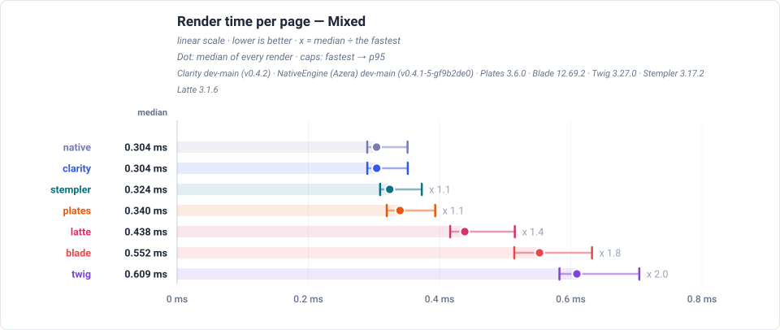
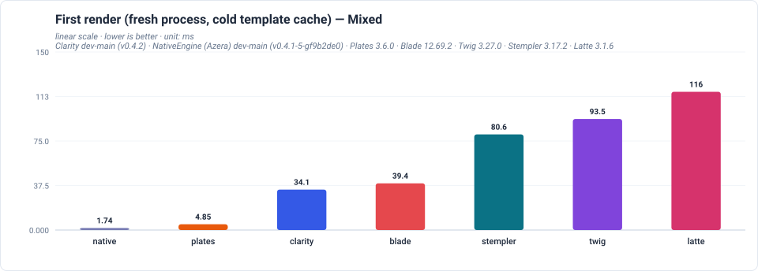
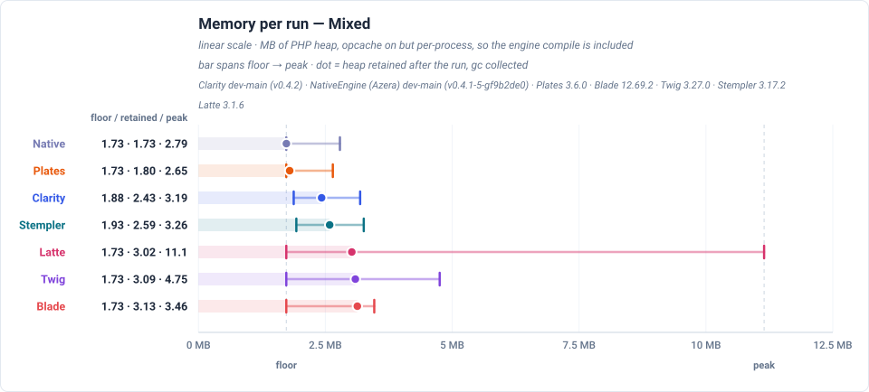
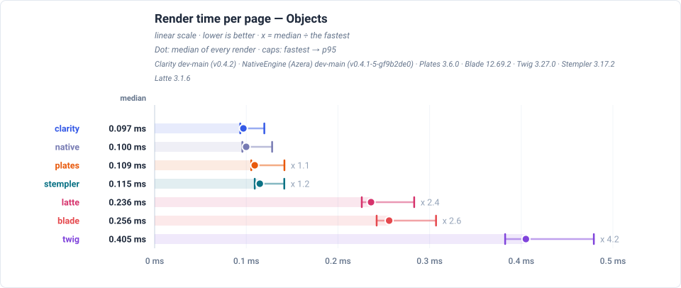
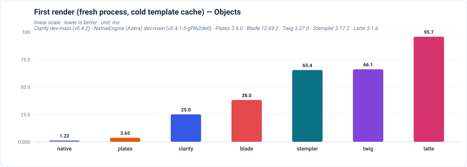
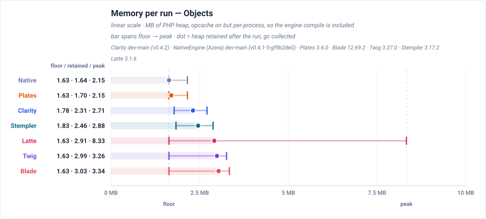

# Benchmark

How Clarity compares with the other popular PHP template engines, across four rendering shapes: a page of scalars, a heavy page of escapes and loops, a page of objects, and the same objects held as nested arrays. The main README shows one of these at a glance; this page is the comparison in full.

> **Generated — do not edit by hand.** Every figure below comes from a benchmark run's own JSON and is re-rendered from it, so the numbers cannot drift from the data they came from. To update this page, re-run the harness and re-publish; see the `azera-competition` repository.

<!-- view-engine:begin -->
Every engine renders the same template shape, in the same session — a difference between two engines is the engines, a difference between two sections is the work the page does. Compare engines WITHIN a shape; a ranking read across sections ranks the pages, not the engines.

## Mixed

What the page renders, and so what these figures are the cost of: the heavy page: 20 flat variables each read twice (as text and as a data-value attribute) plus 20 rows of six fields each, over 40 flat variable accesses per render and 1440 in total at 200 items, with every value HTML-special so the escape path does real work in both the body and an attribute context.

### Time per render — Mixed

Dot: median render · caps: fastest observation and p95 · multiplier: median ÷ the fastest median.

### First render — Mixed

The one-off cost of the first request after a deploy: engine boot, template compile, cache write and one render. Measured once per engine, each in its own fresh process; OPcache is on but its CLI segment is per-process, so the engine source is compiled there too.

### Memory per run — Mixed

Reads the PHP heap. Left cap: what the engine costs to have loaded, nothing rendered. Dot: what a whole run still holds, after a gc pass — memory_get_usage(false) after a whole run of iterations_per_run renders in a fresh process, gc_collect_cycles() called first. Right cap: the run's high-water mark. Memory probe: a fresh process with opcache.enable_cli=1 but a per-process CLI segment, so engine source is compiled in that process. Every reading is deterministic, so this is not a spread of repeats.

### Results — Mixed

Generated from the same rows the charts are drawn from. Rows are ordered by median, fastest first.

| Engine | First render (ms) | Mean (ms) | Median (ms) | Min (ms) | p95 (ms) | Retained (MB) | Peak (MB) |
| --- | ---: | ---: | ---: | ---: | ---: | ---: | ---: |
| Native | 1.735 | 0.311 | 0.304 | 0.290 | 0.351 | 1.73 | 2.79 |
| Clarity | 34.071 | 0.312 | 0.304 | 0.290 | 0.352 | 2.43 | 3.19 |
| Stempler | 80.558 | 0.332 | 0.324 | 0.309 | 0.373 | 2.59 | 3.26 |
| Plates | 4.852 | 0.349 | 0.340 | 0.320 | 0.393 | 1.80 | 2.65 |
| Latte | 116.467 | 0.454 | 0.438 | 0.416 | 0.515 | 3.02 | 11.15 |
| Blade | 39.354 | 0.562 | 0.552 | 0.514 | 0.632 | 3.13 | 3.46 |
| Twig | 93.544 | 0.626 | 0.609 | 0.583 | 0.704 | 3.09 | 4.75 |

## Objects

What the page renders, and so what these figures are the cost of: objects instead of scalars: two properties, a nested object, a nullable property behind a default, and an array inside an object.

### Time per render — Objects

Dot: median render · caps: fastest observation and p95 · multiplier: median ÷ the fastest median.

### First render — Objects

The one-off cost of the first request after a deploy: engine boot, template compile, cache write and one render. Measured once per engine, each in its own fresh process; OPcache is on but its CLI segment is per-process, so the engine source is compiled there too.

### Memory per run — Objects

Reads the PHP heap. Left cap: what the engine costs to have loaded, nothing rendered. Dot: what a whole run still holds, after a gc pass — memory_get_usage(false) after a whole run of iterations_per_run renders in a fresh process, gc_collect_cycles() called first. Right cap: the run's high-water mark. Memory probe: a fresh process with opcache.enable_cli=1 but a per-process CLI segment, so engine source is compiled in that process. Every reading is deterministic, so this is not a spread of repeats.

### Results — Objects

Generated from the same rows the charts are drawn from. Rows are ordered by median, fastest first.

| Engine | First render (ms) | Mean (ms) | Median (ms) | Min (ms) | p95 (ms) | Retained (MB) | Peak (MB) |
| --- | ---: | ---: | ---: | ---: | ---: | ---: | ---: |
| Clarity | 24.994 | 0.101 | 0.097 | 0.093 | 0.120 | 2.31 | 2.71 |
| Native | 1.217 | 0.106 | 0.100 | 0.096 | 0.128 | 1.64 | 2.15 |
| Plates | 3.647 | 0.116 | 0.109 | 0.105 | 0.142 | 1.70 | 2.15 |
| Stempler | 65.374 | 0.120 | 0.115 | 0.109 | 0.141 | 2.46 | 2.88 |
| Latte | 95.730 | 0.246 | 0.236 | 0.226 | 0.283 | 2.91 | 8.33 |
| Blade | 38.039 | 0.264 | 0.256 | 0.242 | 0.307 | 3.03 | 3.34 |
| Twig | 66.078 | 0.416 | 0.405 | 0.382 | 0.479 | 2.99 | 3.26 |

## What the columns are

- **First render** — the first request after a deploy, in a fresh process per engine: boot, compile, cache write, one render. The template cache is cold.
- **Mean / Median / Min / p95** — over every individual render across all runs.
- **Retained** — heap still held after a whole run, after a gc pass, in a fresh process.
- **Peak** — the same run's high-water mark, where the first compile's transient allocation lives. Not a second measurement of Retained.

A few percent is a tie, not a win: it is within a single engine's own run-to-run spread.

**Environment** — PHP 8.5.11 · Linux 6.8.0-139-generic · SAPI cli · OPcache (`opcache.enable_cli`): yes · JIT: tracing (buffer 64M) · Clarity template revalidate: 60 s

**Budget** — 10,000 renders × 30 runs, 200 items per render

**Method** — Steady-state timings: the render loop for each (engine, page) cell runs in its own fresh process against a warm cache: one untimed warm-up render, then runs x iterations-per-run timed renders. No order: each (engine, page) cell is measured in its own process, so measurement order cannot affect a cell. The first render was measured as one render in a fresh process with a cold template cache: engine class loading, template compile, cache write and one render.

**Engines** — Clarity dev-main (v0.4.2) · NativeEngine (Azera) dev-main (v0.4.1-5-gf9b2de0) · Plates 3.6.0 · Blade 12.69.2 · Twig 3.27.0 · Stempler 3.17.2 · Latte 3.1.6

_Measured 2026-11-12T15:15:49+00:00_

The full published report, including the headline page: <https://sailantis.github.io/azera-competition/benchmarks/view-engine.html>
<!-- view-engine:end -->
